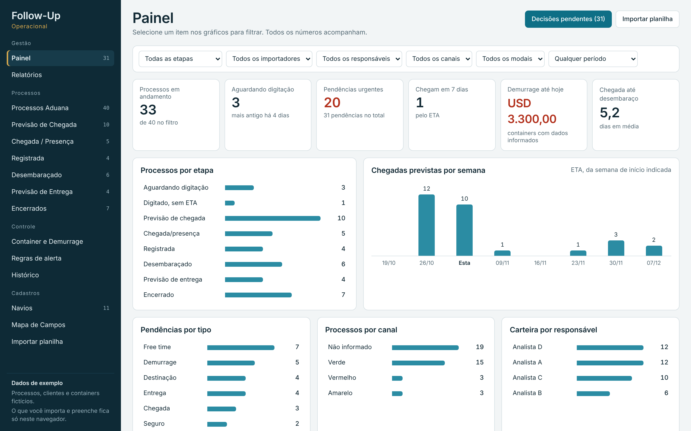
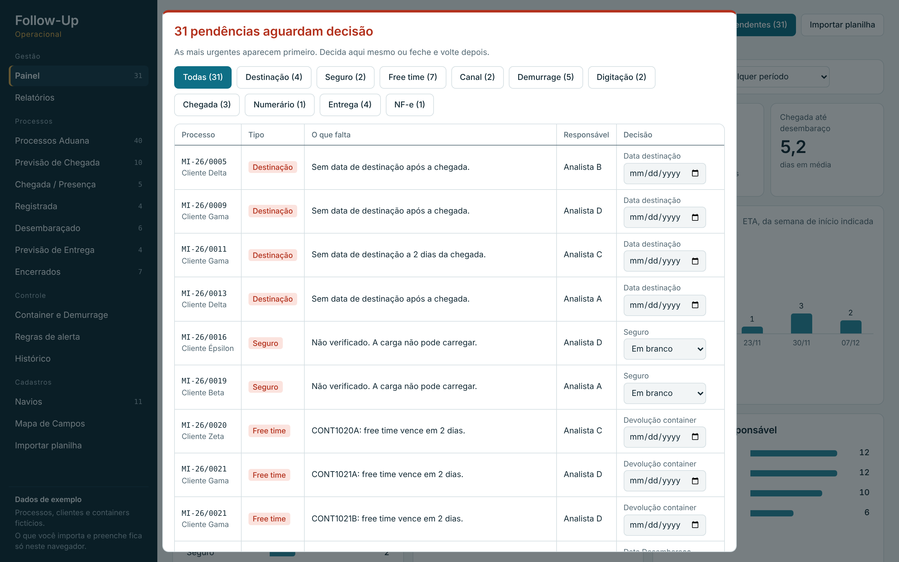
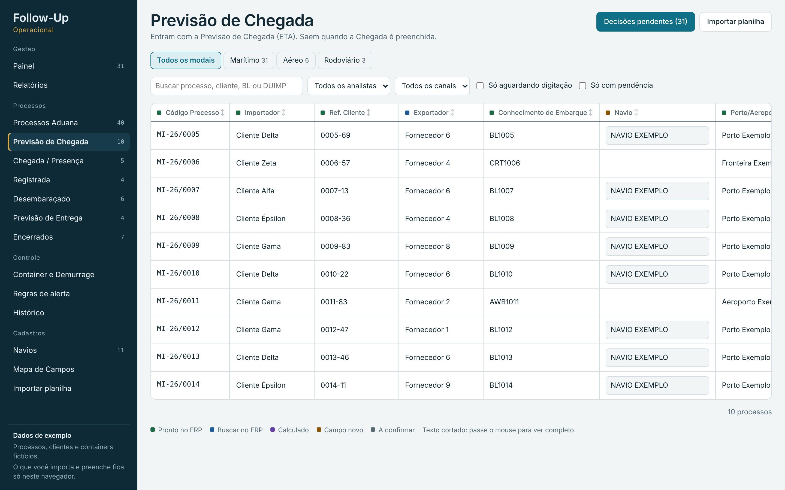
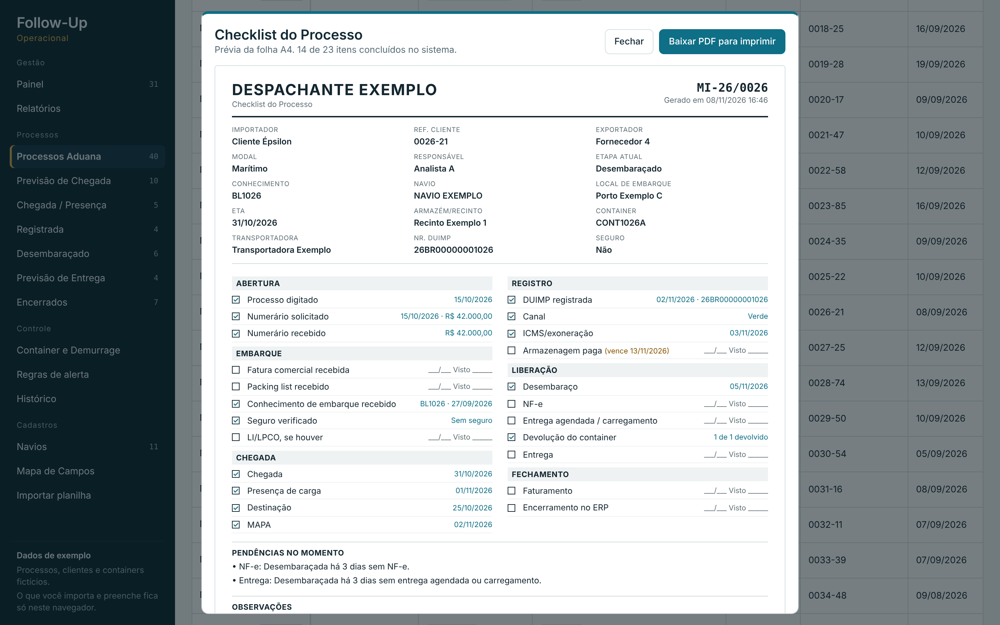
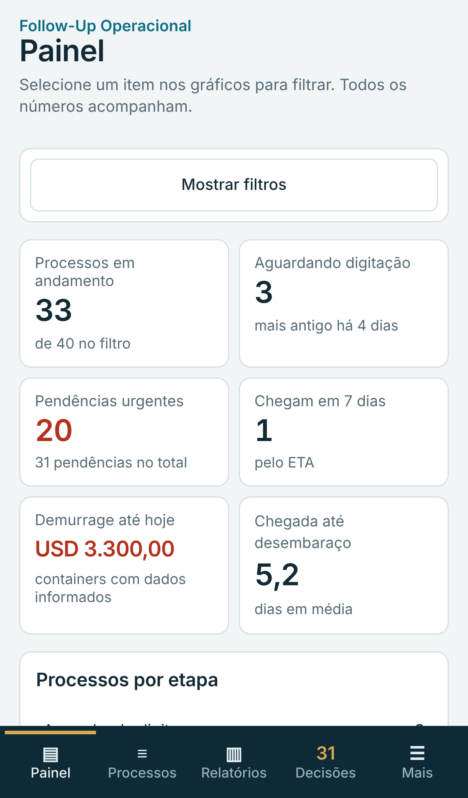

# Follow-Up Operacional

Sistema de acompanhamento de processos de importação para escritórios de despacho aduaneiro, da abertura do processo ao encerramento.

> Versão de demonstração com dados fictícios. Os processos, clientes, fornecedores e containers são exemplos.

**[Abrir a demonstração](https://jefflino7.github.io/follow-up-operacional-demo/)**

## O problema

Em um escritório de despacho, cada processo passa por várias pessoas e etapas. Sem um acompanhamento único, faltam informações, ninguém sabe quem deve preencher cada campo e os prazos se perdem, gerando custos como armazenagem e demurrage.

## Como funciona

O processo anda sozinho pelas etapas conforme as datas são preenchidas:

| Etapa | Entra quando | Sai quando |
|---|---|---|
| Previsão de Chegada | O ETA é informado | A Chegada é preenchida |
| Chegada / Presença de Carga | A Chegada é preenchida | A Data Registro é preenchida |
| Registrada / Ag. Desembaraço | A Data Registro é preenchida | A Data Desembaraço é preenchida |
| Desembaraçado | A Data Desembaraço é preenchida | A entrega é agendada ou o carregamento é informado |
| Previsão de Entrega | A entrega é agendada | A Data Entrega é preenchida |
| Encerrados | Data Entrega, Faturamento ou Encerramento | — |

A cada mudança, o sistema avisa para qual etapa o processo foi, permite desfazer e alerta se uma data vier antes da etapa anterior.

## Funcionalidades

- **Painel interativo:** indicadores e gráficos que filtram todos os números ao serem clicados.
- **Decisões ao entrar no sistema:** uma janela lista as pendências urgentes, como seguro não verificado na chegada, destinação sem data, free time vencendo e processo sem digitação, e permite resolver ali mesmo.
- **16 regras de alerta:** podem ser ligadas, desligadas e ter o prazo ajustado.
- **Controle de digitação:** mostra os processos abertos e ainda não digitados, com os campos que faltam.
- **Demurrage por container:** free time a partir da descarga ou do marco do contrato, vencimento e valor acumulado.
- **Observações com histórico:** anotações por data, uma embaixo da outra, em cada processo.
- **Checklist do processo em PDF:** uma folha A4 para imprimir e deixar na pasta física.
- **Relatórios:** etapas, pendências, carteira por responsável e por importador, demurrage, numerário, tempos e preenchimento, com cópia para o Excel.
- **Importação e exportação de planilhas:** importa o Excel do sistema de despacho com reconhecimento automático das colunas e exporta a lista filtrada.
- **Histórico de alterações:** registra o campo, o valor anterior e o novo.
- **Filtros e ordenação:** por modal (marítimo, aéreo e rodoviário), situação, responsável e canal, com ordenação por qualquer coluna.
- **Uso no celular:** menu inferior e processos em cartões.

## Telas

| Decisões pendentes | Previsão de Chegada |
|---|---|
|  |  |

| Checklist do processo | Celular |
|---|---|
|  |  |

## Tecnologia

- Uma página HTML, com CSS e JavaScript sem framework.
- [SheetJS](https://sheetjs.com/) para ler e gerar planilhas e [pdf-lib](https://pdf-lib.js.org/) para gerar o checklist em PDF.
- Os dados importados e preenchidos ficam salvos no navegador de quem usa (`localStorage`). Nada é enviado para um servidor.

## Como rodar

Abra o `index.html` no navegador, ou publique a pasta no GitHub Pages. É preciso estar conectado à internet para carregar as fontes e as bibliotecas.

## Próximos passos

- Banco de dados compartilhado e login com perfis, para toda a equipe ver os mesmos dados.
- Integração com o sistema de despacho por API, no lugar da importação de planilhas.
- Envio dos alertas por e-mail.

---

Desenvolvido por [Jeferson Lino](https://github.com/jefflino7).
